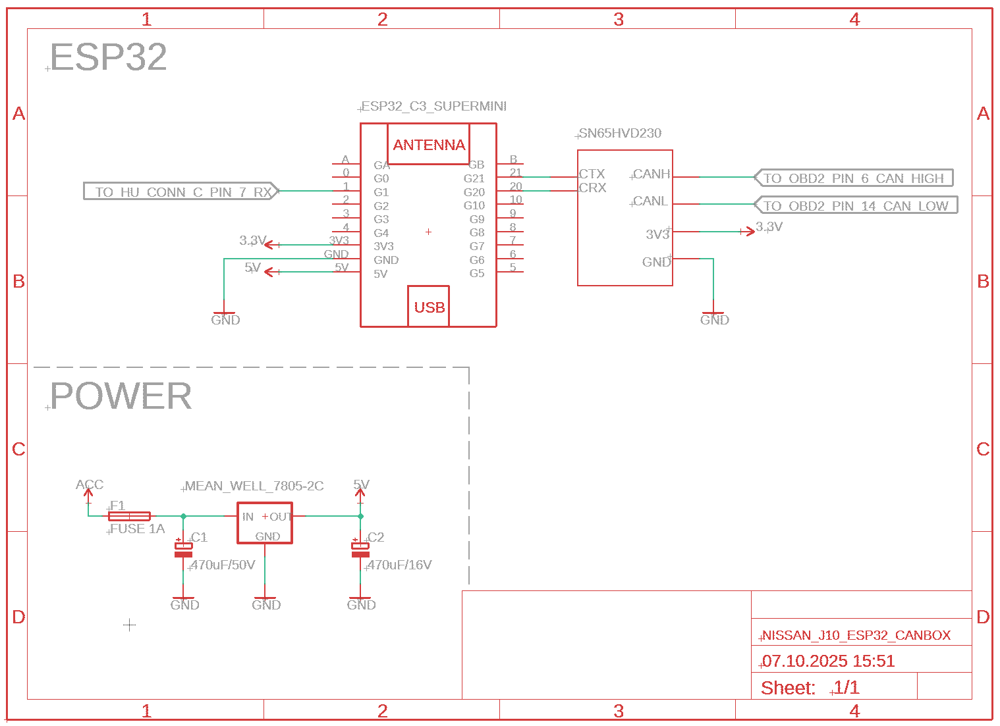

# ESP32 CANBox Bridge

> **Langues disponibles :** **Français** | [English](README.md)

<p align="center">
  
  
</p>

<p align="center">
  
  <br>
  <em>Lignes de guidage dynamiques de la caméra de recul en fonctionnement</em>
</p>

Ce projet est un **pont CAN universel** qui connecte n'importe quel véhicule à un autoradio Android. L'ESP32 lit les trames du bus CAN via le port OBD-II et les traduit vers des protocoles compris par les autoradios Android (Toyota RAV4, Raise, etc.).

Le projet a démarré comme une solution dédiée à la **Nissan Juke F15**, mais a depuis évolué vers une plateforme générique multi-véhicules.

**Points clés :**
- **Support multi-véhicules** — Les mappings CAN spécifiques à chaque véhicule sont définis dans des fichiers de configuration JSON, facilitant l'ajout de nouvelles voitures
- **Traduction de protocoles** — Convertit les données CAN constructeur vers les protocoles autoradio (Toyota RAV4, Raise/RZC)
- **Sans recompilation** — Changez de véhicule, ajustez la calibration via commandes USB, ou intégrez les paramètres de calibration directement dans le fichier JSON du véhicule (`vehicleParams`)

> **Important :** Dans les paramètres de votre autoradio, configurez le protocole CAN sur **"Toyota RAV4"** pour que cela fonctionne.

> **Application requise :** Utilisez **[ESP32 CANBox Manager](https://github.com/aerodomigue/esp32-canbox-manager)** (Android) pour configurer, calibrer et mettre à jour le firmware via USB.

---

## Fonctionnalités

- **Traduction en temps réel** des données CAN Nissan vers le protocole Toyota RAV4
- **Angle de braquage** pour les lignes de guidage de la caméra de recul
- **Données tableau de bord** : RPM, vitesse, tension batterie, température et états du véhicule ; niveau essence selon un mapping validé
- **État des portes** avec mise à jour automatique sur changement
- **Systèmes de sécurité** : Watchdog matériel, surveillance erreurs CAN, protection timeout

### État des Fonctionnalités

État au **7 novembre 2026**, d'après les essais et confirmations du propriétaire
sur son **Juke F15 2011 1.6 DIG-T manuel**. Les fonctions confirmées sont opérationnelles sur ce véhicule. Les ajouts de
trajet depuis démarrage sont documentés séparément ; huile et coefficient de
volume carburant restent provisoires. Extérieur et quantité de carburant sont
indisponibles.

| Fonctionnalité | Statut | Notes |
| --- | --- | --- |
| Vitesse Véhicule | ✅ Fonctionnement confirmé | `0x280` octets 4–5 BE `/100` ; distance intégrée du long trajet cohérente avec le compteur total |
| Kilométrage Total (km) | ✅ Fonctionnement confirmé | `0x5C5` octets 1–3 BE ; retour utilisateur sur le compteur kilométrique |
| Régime Moteur (tr/min) | ✅ Fonctionnement confirmé | `0x180` octets 0–1 BE `/8` ; également corroboré par OBD |
| Direction / Lignes Dynamiques | ✅ Fonctionnement confirmé | `0x002` B0–B1 LE signés, 0,1° ; réglage utilisateur `steerScale=500`, `steerOffset=0`, inversion activée |
| Clignotants | ✅ Fonctionnement confirmé | Gauche/droit ; retour utilisateur après correction de l'état dashboard |
| Portes et Coffre | ✅ Fonctionnement confirmé | Retour utilisateur ; mapping conservé |
| Frein à Main | ✅ Fonctionnement confirmé | `0x5C5[0] & 0x04` ; disponible dans `SYS DATA` |
| Feux | ✅ Fonctionnement confirmé côté boîtier | Position, croisement et pleins phares ; le contrôle de l'affichage des positions dans Manager est [documenté](docs/protocols/USB_SERIAL_PROTOCOL.md#lights-dashboard-field) |
| Tension Batterie | ✅ Fonctionnement confirmé | Également cohérente avec l'OBD : écart moyen 0,139 V, points de mesure potentiellement différents |
| Température Eau Moteur | ✅ Fonctionnement confirmé | Confirmation utilisateur et décodage `0x551[0]−40` corroboré par OBD ; distincte de la température extérieure |
| Température Huile Moteur | Source provisoire activée | `0x580[4]−40` ; acceptée explicitement pour comparaison, identité non confirmée indépendamment ; paquet UART eau/huile de quatre octets |
| Niveau Essence | Indisponible dans le preset Juke | Fausse jauge `0x5C5[0]` retirée ; `FuelValid: 0` distingue la valeur de compatibilité `0 L` d'une mesure |
| Pédale de frein | Non validée | `0x180[7] & 0x01` ; geste et polarité à vérifier séparément sur le véhicule |
| Température Extérieure | Indisponible dans le preset F15 | Mapping incorrect `0x540[0]−40` retiré ; photos à 14 °C contre ses 28 °C |
| Conso. Instantanée | Approximative, à calibrer | Compteur `0x551[1]` et vitesse `0x280` ; 80 mm³/incrément provisoires ; fenêtre de 1 s ; L/100 km sur UART |
| Conso. Moyenne | Estimation provisoire depuis démarrage | RAM, ralenti inclus, disponible après 100 m ; rechargement identique préservé ; une interruption invalide la moyenne de tout le trajet |
| Autonomie Restante | Fortement corroborée | `0x2DE` octets 6–7 BE `/10` km ; capture contrôlée cohérente avec les photos |

> **Note :** La documentation du protocole Raise/Toyota RAV4 utilisé par les autoradios Android est rare. Certaines fonctionnalités sont encore en cours de reverse-engineering par manque de spécifications officielles du protocole.

Voir la **[Roadmap](ROADMAP.md)** pour les fonctionnalités à venir.
Le [contrat actuel F15 → DUDU, unités et trajet depuis démarrage](docs/F15_DUDU_BOOT_TRIP_MAPPING.fr.md)
décrit vitesse, autonomie, consommation, trajets virtuels A/B et diagnostic Nissan borné.
Le [mapping CAN documenté FR/EN](docs/JUKE_F15_CAN_MAPPING.fr.md) contient les
preuves CAN/OBD, les sources et les limites. Le preset corrigé du dépôt doit
être transféré séparément pour remplacer le JSON installé sur l'ESP32.

---

## Matériel Requis

### Liste des Composants (BOM)

| Composant | Description | Lien |
| --- | --- | --- |
| **ESP32-C3 SuperMini** | Microcontrôleur avec TWAI (CAN) natif | [AliExpress](https://fr.aliexpress.com/item/1005007479144456.html) |
| **SN65HVD230** | Transceiver CAN (3.3V) | [AliExpress](https://fr.aliexpress.com/item/1005009371955871.html) |
| **L7805CV** | Régulateur de tension 5V | [AliExpress](https://fr.aliexpress.com/item/1005005961287271.html) |
| **Carte prototype PCB** | Plaque à trous 4x6cm | [AliExpress](https://fr.aliexpress.com/item/1005008880680070.html) |
| **Condensateur 25V 470µF** | Condensateur de filtrage | [AliExpress](https://fr.aliexpress.com/item/1005002075527957.html) |
| **Bornier PCB** | Borniers à vis pour câblage | [AliExpress](https://fr.aliexpress.com/item/1005006642865467.html) |
| **Fusible 1A** | Fusible de protection | [AliExpress](https://fr.aliexpress.com/item/1005001756852562.html) |
| **Prise OBD-II** | CAN-H (pin 6), CAN-L (pin 14) | - |

### Note sur l'Alimentation

L'ESP32 est alimenté via **USB depuis l'autoradio Android**.

**IMPORTANT - Si vous utilisez le 12V au lieu de l'USB :**
- **Ne JAMAIS utiliser le 12V permanent** - cela viderait la batterie en stationnement
- **Utiliser uniquement le 12V ACC (accessoire)** - il se coupe avec le contact
- Vous aurez besoin d'un régulateur de tension (comme le L7805CV dans le BOM) pour convertir le 12V en 5V
- **Le circuit 12V actuel nécessite des améliorations** : Il manque une protection contre l'inversion de polarité (risque de dommage en cas de mauvais câblage) et un filtrage correct du bruit électrique généré par l'alternateur. Des composants supplémentaires (diode, condensateurs, diode TVS) seraient recommandés pour une alimentation 12V robuste.

**Pourquoi l'USB est recommandé :**
1. **Gestion automatique de l'alimentation** : L'USB de l'autoradio n'est actif que lorsque le poste est allumé (contrôlé par ACC), évitant ainsi de vider la batterie.
2. **Stabilité de la tension** : Le 12V automobile est instable - il varie significativement au démarrage (chutes de tension), pendant la charge de l'alternateur (pics jusqu'à 14.5V), et contient du bruit électrique. L'USB fournit une alimentation 5V propre et régulée.

### Schéma de Câblage

<p align="center">
  
  <br>
  <em>Schéma réalisé par Polihedron</em>
</p>

### Câblage (Pinout)

| Composant | Pin ESP32 | Destination | Note |
| --- | --- | --- | --- |
| **SN65HVD230** | `3.3V` / `GND` | Alimentation | **Ne pas utiliser 5V !** |
| | `GPIO 21` | CAN-TX | Sortie vers bus CAN |
| | `GPIO 20` | CAN-RX | Entrée depuis bus CAN |
| **Autoradio** | `GPIO 5` (TX) | Fil RX (Faisceau radio) | UART 38400 baud |
| | `GPIO 6` (RX) | Fil TX (Faisceau radio) | Réponses handshake |
| **LED Statut** | `GPIO 8` | LED Interne | Indicateur visuel |

### Connexion OBD-II

Le système se connecte au véhicule via le **port diagnostic OBD-II** :

```
Connecteur OBD-II (vue face au port)
┌─────────────────────────────┐
│  1   2   3   4   5   6   7  8  │
│                                 │
│  9  10  11  12  13  14  15  16 │
└─────────────────────────────┘

Pin 6  = CAN-H (High)
Pin 14 = CAN-L (Low)
Pin 16 = +12V Batterie
Pin 4/5 = Masse
```

> **Terminaison CAN :** Un bus CAN haute vitesse comporte normalement une terminaison de 120Ω à chaque extrémité, comme décrit dans la [fiche technique Texas Instruments du SN65HVD230](https://www.ti.com/lit/ds/symlink/sn65hvd230.pdf). En se branchant sur un bus véhicule déjà terminé via l’OBD-II, le module constitue un nœud supplémentaire et ne doit pas ajouter une troisième terminaison de 120Ω. Si le module comporte une terminaison de 120Ω entre CAN-H et CAN-L, désactiver cette terminaison pour ce raccordement ; le connecteur OBD-II lui-même ne fournit pas de terminaison.

### Pinout Connecteur Électrochauffant (Clim) — M25

L'unité de contrôle électrochauffante utilise le connecteur **M25** (type TH16FW-NH, 16 broches). Il transporte le bus CAN et peut servir de point de prise alternatif.

```
Vue frontale du connecteur :
┌─────────────────────────────────┐
│  1  2  3  4  5  6  7  8        │
│  9 10 11 12 13 14 15 16        │
└─────────────────────────────────┘
```

| Broche | Couleur fil | Description |
| --- | --- | --- |
| 1 | L | **CAN-H** |
| 2 | B | Masse |
| 3 | SB | Alimentation contact (allumage) |
| 4 | P | Signal de réveil de l'unité électrochauffante |
| 5 | R | Masse capteur température ambiante |
| 9 | P | **CAN-L** |
| 10 | Y | Alimentation batterie |
| 12 | GR | Signal capteur température ambiante |
| 13 | L | Signal moteur ventilation |
| 14 | Y | Signal commande relais électrochauffant 1 |
| 15 | LG | Signal commande relais électrochauffant 2 |
| 16 | P | Signal commande relais électrochauffant 3 |

> Les broches 6, 7, 8 et 11 ne sont pas câblées sur ce connecteur.

### À propos du Boîtier CAN d'Origine

Le **boîtier CAN Raise/RZC d'origine** livré avec l'autoradio Android est **conservé en place**. Il fournit l'**alimentation 6V pour la caméra de recul** et reste nécessaire pour cette fonction.

Le boîtier d'origine a probablement accès au signal CAN sur son connecteur, il serait donc possible de récupérer le bus CAN depuis celui-ci au lieu de l'OBD-II. Cependant, cela n'a pas été testé - la connexion OBD-II fonctionne bien et est plus simple à installer.

---

## Configuration USB (V2)

Le boîtier peut être configuré via USB série sans recompilation. Connectez-vous au port USB et utilisez un terminal à **115200 baud**.

### Commandes Disponibles

| Commande | Description |
| --- | --- |
| `CFG LIST` | Afficher les paramètres de calibration |
| `CFG SET <param> <valeur>` | Modifier un paramètre |
| `CFG SAVE` | Sauvegarder en flash (NVS) |
| `CAN STATUS` | État de la config CAN (MOCK/REAL, ou ERROR sans profil valide) |
| `CAN LIST` | Lister les fichiers de config véhicule |
| `CAN LOAD <fichier>` | Charger une config véhicule |
| `CAN UPLOAD START/DATA/END` | Upload config via Base64 |
| `LOG ON` | Capture CAN brute horodatée et lectures OBD service 01 supportées |
| `LOG OFF` | Arrêter la capture et les nouvelles requêtes OBD |
| `SYS INFO` | Informations système |
| `SYS DATA` | Données véhicule en temps réel |
| `HELP` | Liste complète des commandes |

Voir la **[Documentation du Protocole USB Série](docs/protocols/USB_SERIAL_PROTOCOL.md)** pour les détails complets.

### Capturer le CAN et les références OBD

Envoyer `LOG ON` en mode véhicule réel pour enregistrer les trames CAN brutes
et interroger les PIDs OBD annoncés par les calculateurs. Les lignes de
diagnostic commencent par le préfixe exact `ODB` : `ODB TX` pour les requêtes,
`ODB RAW_RX` pour les réponses brutes et `ODB RX` pour les références décodées.
`t_ms` indique le retrait de la file pour les trames reçues et l’instant de
tentative pour les requêtes. Les octets restent inchangés.

`LOG OFF` arrête la capture et les nouvelles requêtes. Le mode mock n’envoie
aucune requête OBD et l’OTA suspend les lectures. Les références ne changent
ni le preset actif, ni les valeurs envoyées à l’autoradio. Le
[guide de capture et comparaison](docs/OBD_CALIBRATION.fr.md) décrit les unités,
timeouts, compteurs de pertes et commandes d’enregistrement.

La lecture CAN continue pendant une requête OBD en cours. Un tampon USB de
64 Kio conserve l'ordre des lignes et reprend les écritures partielles sans
attendre l'hôte. `ODB BUFFER` expose l'occupation et les pertes éventuelles
si l'hôte reste trop lent. Voir la [validation du streaming firmware](docs/LOG_STREAMING_VALIDATION.fr.md)
et le [format de routage pour les clients](docs/protocols/USB_SERIAL_PROTOCOL.md#routing-the-shared-stream).

### Support Multi-Véhicules

Les configurations véhicules sont stockées sous forme de fichiers JSON sur le filesystem du boîtier. Vous pouvez :
- Uploader plusieurs configs véhicules (NissanJukeF15.json, ToyotaCorolla.json, etc.)
- Basculer entre véhicules avec `CAN LOAD <fichier>`
- Utiliser le **Mode Mock** pour tester sans véhicule

---

## Architecture Logicielle

Le système est conçu pour être 100% autonome et résistant aux parasites électriques du véhicule :

1. **[Capture CAN](docs/technical/CAN_CAPTURE.md)** : Décode les trames selon la configuration JSON et met à jour les variables globales
2. **[Envoi Radio](docs/technical/RADIO_SEND.md)** : Formate et transmet les données au poste à plusieurs intervalles (200ms pour direction, 333ms pour RPM, 500ms pour vitesse, etc.)
3. **ConfigManager** : Stockage persistant des paramètres de calibration (NVS). Les valeurs explicites de `vehicleParams` dans le JSON sont prioritaires à chaque chargement et redémarrage ; les ajustements `CFG SET` ne survivent au rechargement que pour les clés nulles/absentes. Pour partager une calibration, mettre à jour le JSON sur chaque poste
4. **SerialCommand** : Interface de configuration USB
5. **Watchdog Matériel** : Redémarrage automatique si le programme gèle plus de 5 secondes
6. **Watchdog CAN** : Force un reboot si aucune donnée CAN reçue pendant 30s alors que batterie > 11V

---

## Codes LED de Statut

La LED (GPIO 8) permet un diagnostic rapide sans connexion PC :

| Pattern | Statut | Signification |
| --- | --- | --- |
| **Clignotement rapide** | Normal | Données CAN reçues et traitées |
| **Clignotement lent (500ms)** | Mode Mock | Données simulées en cours |
| **Battement lent (1s)** | Veille | Système actif, mais bus CAN silencieux |
| **Allumée fixe au boot** | Démarrage | Système en initialisation |
| **Aucune activité** | Erreur | Système figé ou problème d'alimentation |

---

## Photos du Montage

### Assemblage PCB

<p align="center">
  
  
</p>

*ESP32 avec transceiver CAN SN65HVD230 soudé sur plaque à trous*

---

## Installation et Configuration

Pour compiler et tester localement, voir [Développement](docs/DEVELOPMENT.md).
Le [rapport de validation de la PR #10](docs/PR10_VALIDATION.fr.md) décrit les
correctifs de décodage, le retrait des propositions et les vérifications réalisées.
Le [mapping du Juke F15 2011](docs/JUKE_F15_CAN_MAPPING.fr.md) confronte les
captures récentes, les références OBD et les définitions publiques Racelogic.
L'[analyse historique](docs/JUKE_2011_CAN_ANALYSIS.fr.md) conserve le diagnostic
de l'ancien enregistreur et ses limites.
Les propositions de la PR et leur profil expérimental ont été retirés. `LOG ON`
enregistre maintenant les trames CAN brutes horodatées et lance les lectures
OBD service 01 supportées ; chaque ligne de diagnostic commence par `ODB`.
Voir [la capture pour calibration OBD](docs/OBD_CALIBRATION.fr.md).

L'installation de votre pont CAN ESP32 se déroule en deux étapes simples :

### 1. Flash Initial du Firmware
L'ESP32 doit d'abord être programmé avec le firmware avant d'être installé. Utilisez l'une des méthodes suivantes :

- **Option A : Navigateur Web (Recommandé)**
  Ouvrez **[web.esphome.io](https://web.esphome.io/)** dans un navigateur basé sur Chrome.
  1. Téléchargez le fichier **`all-firmware.bin`** depuis la page des [Dernières Releases](https://github.com/aerodomigue/Nissan-canbus-headunit/releases). Ce fichier unique contient le bootloader, les partitions et l'application.
  2. Connectez votre ESP32 à votre ordinateur via USB.
  3. Cliquez sur **Connect**, puis **Install** et sélectionnez le fichier `all-firmware.bin`.

- **Option B : PlatformIO (Développeurs)**
  Si vous travaillez avec le code source :
  ```bash
  pio run --target upload
  ```
  *Note : Un fichier `all-firmware.bin` est généré automatiquement dans `.pio/build/` après chaque compilation.*

### 2. Configuration et Pilotage
Une fois flashé, branchez l'ESP32 sur un port USB de votre autoradio Android. Toute la configuration se fait ensuite via l'application compagnon :

**[ESP32 CANBox Manager](https://github.com/aerodomigue/esp32-canbox-manager)** (App Android)
- **Sélection du Véhicule** : Chargez la config `.json` correspondant à votre voiture.
- **Calibration** : Réglez les offsets du volant ou la capacité du réservoir.
- **Mises à jour OTA** : Mettez à jour les futures versions du firmware par USB série depuis l'app avec **`firmware.ota`**. Le preset véhicule se charge séparément.

Pour le preset Juke corrigé, installer **d'abord le firmware correspondant**,
puis transférer `data/NissanJukeF15.json` et l'activer avec `CAN LOAD NissanJukeF15.json`.
L'OTA applicative ne met **pas** LittleFS à jour. Un ancien firmware peut
interpréter une cible inconnue comme `HANDBRAKE` en `STEERING` ; ne pas lui
charger le nouveau JSON. Le nouveau parseur rejette les cibles inconnues ou
absentes en conservant le profil précédemment actif.

Le JSON F15 renseigne maintenant les sept réglages de calibration :

```json
"vehicleParams": {
  "steerScale": 500,
  "steerOffset": 0,
  "steerInvert": true,
  "indTimeout": 500,
  "rpmDiv": 8,
  "tankCap": 45,
  "dteDiv": 338
}
```

Le propriétaire a confirmé `500` : `1000` faisait trop tourner les lignes.
Cela applique `UART = clamp(-trunc(brut/20), -500, 500)`, soit une demi-unité
UART par degré F15 avant arrondi. Avec le firmware correspondant, `CAN LOAD`,
`CAN RELOAD` et le redémarrage réappliquent les valeurs explicites du JSON,
même pour le même fichier. Vérifier avec `CFG LIST`. `CFG SET`/`CFG SAVE`
n'écrivent pas dans le JSON : les ajustements durables et partagés doivent
être reportés dans le fichier. Les clés nulles/absentes peuvent toujours
conserver un réglage local au rechargement.

Un échec de `CAN RELOAD` renvoie `ERROR` et conserve le profil actif ainsi que
la calibration. Si le JSON sélectionné manque ou est invalide au démarrage,
les logs CAN/OBD et l'USB restent disponibles, avec les sorties radio désactivées
jusqu'au chargement d'un profil valide ; aucune bascule automatique en démo.
Seules les clés explicites du JSON sont sauvegardées au rechargement : un
réglage local sur une clé nulle/absente nécessite toujours `CFG SAVE` pour
survivre au redémarrage. Les valeurs entières comme `500.0` restent compatibles.

`rpmDiv`, `tankCap` et `dteDiv` sont des réglages historiques mémorisés mais
actuellement inutilisés par le décodeur. `rpmDiv: 8` reprend la formule du régime ;
l'ancien `dteDiv: 338` ne contrôle pas la conversion corrigée `0x2DE /10`.
`tankCap: 45` conserve une valeur historique, pas une capacité de réservoir F15 validée. Les paramètres de
consommation restent dans `fuelConsumption`. Voir le [guide des presets](docs/VEHICLE_PRESET_GUIDE.md#vehicle-parameters-vehicleparams).

---

## Données Supportées

| Donnée | ID CAN | Fréq. envoi | Notes |
| --- | --- | --- | --- |
| Angle Volant | 0x002 | 200 ms | Confirmé avec `scale=500`, `offset=0`, inversion ; B0–B1 LE signés en 0,1° ; UART limité à ±500 |
| Régime Moteur | 0x180 | 333 ms | B0–B1 BE /8 ; brut `FFFF` indisponible ; UART `7D/0A` en régime ×4 LE |
| Vitesse Véhicule | 0x280 | 500 ms | B4–B5 BE /100 km/h ; brut `FFFF` indisponible ; `7D/03` inclut vitesse et moyenne du démarrage en 0,01 km/h |
| Frein à Main | 0x5C5 | Sur requête `SYS DATA` | B0 bit2 ; pas d'UART `7D/06`, car le champ associé de ceinture reste inconnu |
| Pédale de frein | 0x180 | Sur requête `SYS DATA` | B7 bit0 ; état brut de contact, polarité physique à vérifier |
| Compteur carburant brut | 0x551 | Sur requête `SYS DATA` | B1 conservé brut 0–255 ; `FuelConsEstimated: 1` indique la conversion provisoire séparée |
| Niveau Essence | — | — | Aucune source Juke ; compatibilité `Fuel: 0 L` avec `FuelValid: 0` |
| Tension Batterie | 0x6F6 | Sur requête `SYS DATA` | Mesure Nissan disponible ; la carte tension DUDU examinée utilise une source MCU interne |
| Température Extérieure | — | Aucun envoi UART | Ancien mapping incorrect `0x540` retiré ; aucun remplacement validé |
| Température Eau Moteur | 0x551 | 5000 ms | B0−40 °C ; `7D/09` LEN4 `[09,c+40,c+40,oil+40]`, deux sources fraîches ; FYT lit D2, DUDU D1 |
| Température Huile Moteur | 0x580 | 5000 ms | B4−40 °C, source provisoire ; même paquet commun LEN4, huile DUDU en D3 ; deux sources fraîches |
| État Portes | 0x60D | 250 ms | Toutes portes et coffre, ou sur changement ; mapping fonctionnel conservé |
| Clignotants / Feux | 0x60D | 200 ms ou sur changement | UART `7D/01` et ligne `Lights:` de `SYS DATA` |
| Autonomie | 0x2DE | 5000 ms | B6–B7 BE /10 km ; `21` contient autonomie en km entiers, moyenne du démarrage et temps en 0,1 km/h/minutes |
| Conso. Instantanée / Moyenne | 0x551 + 0x280 | 1000 ms / 5000 ms | Estimation en 0,1 L/100 km ; moyenne RAM du démarrage, ralenti inclus, après 100 m ; valeurs courantes invalides non émises, jamais envoyées en `FFFF` |
| Compteur km / trajets virtuels A et B | 0x5C5 + 0x280 | 10000 ms | ODO B1–B3 BE en km ; `7D/04` porte ODO et deux copies du trajet intégré depuis démarrage en 0,1 km, pas les A/B Nissan ; trajet complet requis |

Voir le [contrat actuel de mapping et disponibilité](docs/F15_DUDU_BOOT_TRIP_MAPPING.fr.md)
pour la fraîcheur, les différences de décodeurs et les calibrations provisoires.

---

## Application Compagnon

**[ESP32 CANBox Manager](https://github.com/aerodomigue/esp32-canbox-manager)** - Application Android pour configurer et surveiller le CANBox via USB.

Fonctionnalités :
- Tableau de bord données véhicule en temps réel
- Gestion des configurations CAN
- Réglage des paramètres de calibration
- Mises à jour firmware (OTA)
- Débogage des trames CAN

---

## Références & Crédits

### Documentation CAN Nissan

- **[Mapping actuel F15 → DUDU, unités et trajet depuis démarrage](docs/F15_DUDU_BOOT_TRIP_MAPPING.fr.md)** — [version anglaise](docs/F15_DUDU_BOOT_TRIP_MAPPING.md)
- [Mapping Juke F15 et preuves de capture](docs/JUKE_F15_CAN_MAPPING.fr.md)
- [Catalogue des PDF Nissan et limites de millésime](docs/vehicle/nissan-juke-f15/README.fr.md)
- [Racelogic / VBOX : documents et définitions CAN](https://vboxautomotive.co.uk/en/can-database-documents)
- [NICOclub / Manuels Nissan](https://www.nicoclub.com/nissan-service-manuals)
- [Comma.ai / OpenDBC](https://github.com/commaai/opendbc/tree/master)
- [jackm / Carhack Nissan](https://github.com/jackm/carhack/blob/master/nissan.md)
- [balrog-kun / Nissan Qashqai CAN info](https://github.com/balrog-kun/nissan-qashqai-can-info)

### Protocoles Radio (Toyota/Raise/RZC)

- **[Contrat d'encodage UART DUDU7 Toyota/RAV4 — PDF français](docs/protocols/raise-toyota-rav4/ENCODAGE_UART_DUDU7_RAV4.fr.pdf)** — Commandes dans les deux sens, positions des bits, types, ordre des octets, unités, conversions et exemples de trames ; [PDF anglais](docs/protocols/raise-toyota-rav4/ENCODAGE_UART_DUDU7_RAV4.en.pdf)
- [Index de la documentation Toyota/RAV4 et limites de validation](docs/protocols/raise-toyota-rav4/README.fr.md) — Distingue les décodeurs FYT et DUDU, les formats établis et la validation matérielle
- **[Analyse du Protocole Toyota RAV4](docs/protocols/raise-toyota-rav4/RAV4_BODY_ENGINE_2018_2020.pdf)** - Compilé et analysé par [Mikescotland](https://forum.dudu-auto.com/u/Mikescotland) (Source Originale)
- [Protocole Raise Officiel (Chinois)](docs/protocols/raise-toyota-rav4/) - Documentation supplémentaire
- [smartgauges / canbox](https://github.com/smartgauges/canbox)
- [cxsichen / Protocole Raise](https://github.com/cxsichen/helllo-world/tree/master/%E5%8D%8F%E8%AE%AE/%E7%9D%BF%E5%BF%97%E8%AF%9A)
- [Forum DUDU-AUTO / Qashqai 2011 CANbus](https://forum.dudu-auto.com/d/1786-nissan-qashqai-2011-canbus/6)

---

## Licence

Ce projet est open source. Voir [LICENSE](LICENSE) pour les détails.
