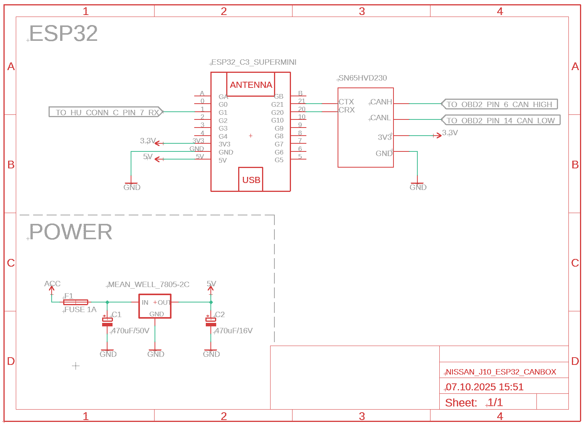

# ESP32 CANBox Bridge

> **Available Languages:** [Français](README.fr.md) | **English**

<p align="center">
  
  
</p>

<p align="center">
  
  <br>
  <em>Dynamic reverse camera guidelines working with the CAN bridge</em>
</p>

This project is a **universal CAN bridge** that connects any vehicle to an Android head unit. The ESP32 reads CAN bus frames via the OBD-II port and translates them to protocols understood by Android head units (Toyota RAV4, Raise, etc.).

The project started as a custom solution for the **Nissan Juke F15**, but has since evolved into a generic, multi-vehicle platform.

**Key features:**
- **Multi-vehicle support** — Vehicle-specific CAN mappings are defined in JSON configuration files, making it easy to add support for new cars
- **Protocol translation** — Converts manufacturer-specific CAN data to head unit protocols (Toyota RAV4, Raise/RZC)
- **No recompilation needed** — Switch vehicles, adjust calibration via USB commands, or embed model-specific calibration directly in the vehicle JSON preset (`vehicleParams`)

> **Important:** In your head unit settings, configure the CAN protocol as **"Toyota RAV4"** for this to work.

> **Required App:** Use **[ESP32 CANBox Manager](https://github.com/aerodomigue/esp32-canbox-manager)** (Android) to configure, calibrate, and update the firmware via USB.

---

## Features

- **Real-time data translation** from Nissan CAN to Toyota RAV4 protocol
- **Steering wheel angle** for reverse camera guidelines
- **Dashboard data**: RPM, speed, battery voltage, temperature and vehicle states; fuel level depends on a validated vehicle mapping
- **Door status** with automatic updates on change
- **Safety systems**: Hardware watchdog, CAN error monitoring, timeout protection

### Feature Status

| Feature | Status | Notes |
| --- | --- | --- |
| Engine RPM | Corrected in the preset | `0x180` bytes 0–1 BE `/8`, corroborated by OBD |
| Vehicle Speed | Corrected in the preset | `0x284` bytes 4–5 BE `/100`; OBD corroboration covers low speed |
| Fuel Tank Level | Unavailable in the Juke preset | False `0x5C5[0]` gauge removed; `FuelValid: 0` distinguishes the compatibility value `0 L` from a measurement |
| Battery Voltage | Consistent with OBD | Mean absolute difference 0.139 V; potentially different measurement points |
| Steering / Dynamic Guidelines | Feature implemented | Angle units, zero and sign need validation on this variant |
| Door Status | Feature implemented | Verify each door/bit correspondence with separate actions |
| Indicators | ✅ Operation confirmed | Owner feedback after the dashboard state fix |
| Lights | Feature implemented | Headlights, high beam, parking lights; no annotated sequence in the latest capture |
| Handbrake | Decoded in the preset | `0x5C5[0] & 0x04`, corroborated by Juke source and owner maneuver; available in `SYS DATA` |
| Brake pedal | Raw switch bit decoded | `0x180[7] & 0x01`; action and polarity still need a separate vehicle check |
| External Temperature | Calibration pending | `0x540[0]−40`; no independent reference in the log |
| Instant Fuel Consumption | Unavailable in the Juke preset | `0x580[3]` removed; `0x551[1]` exposed only as `FuelRaw`, without a physical unit |
| Average Fuel Consumption | Unavailable in the Juke preset | Unvalidated `0x580[4]` removed; no consumption UART message without an available source |
| Distance to Empty | Unit unverified | Initial CAN 0x54C mapping restored; dashboard reference needed |

> **Note:** Documentation for the Raise/Toyota RAV4 protocol used by Android head units is scarce. Some features are still being reverse-engineered due to lack of official protocol specifications.

See the **[Roadmap](ROADMAP.md)** for upcoming features.
The [documented CAN mapping in EN/FR](docs/JUKE_F15_CAN_MAPPING.md) records
CAN/OBD evidence, sources and limitations. The corrected repository preset
must be uploaded separately to update the JSON installed on the ESP32.

---

## Hardware Requirements

### Bill of Materials (BOM)

| Component | Description | Link |
| --- | --- | --- |
| **ESP32-C3 SuperMini** | Microcontroller with native TWAI (CAN) | [AliExpress](https://fr.aliexpress.com/item/1005007479144456.html) |
| **SN65HVD230** | CAN Transceiver (3.3V) | [AliExpress](https://fr.aliexpress.com/item/1005009371955871.html) |
| **L7805CV** | 5V Voltage Regulator | [AliExpress](https://fr.aliexpress.com/item/1005005961287271.html) |
| **PCB Prototype Board** | 4x6cm perfboard | [AliExpress](https://fr.aliexpress.com/item/1005008880680070.html) |
| **Capacitor 25V 470µF** | Filtering capacitor | [AliExpress](https://fr.aliexpress.com/item/1005002075527957.html) |
| **PCB Terminal Block** | Screw terminals for wiring | [AliExpress](https://fr.aliexpress.com/item/1005006642865467.html) |
| **Fuse 1A** | Protection fuse | [AliExpress](https://fr.aliexpress.com/item/1005001756852562.html) |
| **OBD-II Plug** | CAN-H (pin 6), CAN-L (pin 14) | - |

### Power Supply Note

The ESP32 is powered via **USB from the Android head unit**.

**IMPORTANT - If using 12V power instead of USB:**
- ⚠️ **NEVER use permanent 12V** - it will drain your car battery when parked
- ✅ **Use ACC (accessory) 12V only** - it turns off with the ignition
- You'll need a voltage regulator (like the L7805CV in the BOM) to convert 12V to 5V
- ⚠️ **The current 12V circuit needs improvements**: It lacks reverse polarity protection (risk of damage if wired incorrectly) and proper noise filtering for alternator-generated electrical interference. Additional components (diode, capacitors, TVS diode) would be recommended for a robust 12V power supply.

**Why USB is recommended:**
1. **Automatic power management**: USB power from the head unit is only active when the head unit is on (ACC-controlled), preventing battery drain.
2. **Voltage stability**: Automotive 12V is unstable - it varies significantly during engine start (voltage drops), alternator charging (spikes up to 14.5V), and contains electrical noise. USB provides clean, regulated 5V power.

### Wiring Diagram

<p align="center">
  
  <br>
  <em>Schematic by Polihedron</em>
</p>

### Pinout

| Component | ESP32 Pin | Destination | Note |
| --- | --- | --- | --- |
| **SN65HVD230** | `3.3V` / `GND` | Power Supply | **Do not use 5V!** |
| | `GPIO 21` | CAN-TX | Output to CAN bus |
| | `GPIO 20` | CAN-RX | Input from CAN bus |
| **Head Unit** | `GPIO 5` (TX) | RX Wire (Radio harness) | UART 38400 baud |
| | `GPIO 6` (RX) | TX Wire (Radio harness) | Handshake responses |
| **Status LED** | `GPIO 8` | Internal LED | Visual status indicator |

### OBD-II Connection

The system connects to the vehicle via the **OBD-II diagnostic port**:

```
OBD-II Connector (looking at port)
┌─────────────────────────────┐
│  1   2   3   4   5   6   7  8  │
│                                 │
│  9  10  11  12  13  14  15  16 │
└─────────────────────────────┘

Pin 6  = CAN-H (High)
Pin 14 = CAN-L (Low)
Pin 16 = +12V Battery
Pin 4/5 = Ground
```

> **CAN termination:** A high-speed CAN bus normally has a 120Ω termination at each end, as described in the [Texas Instruments SN65HVD230 datasheet](https://www.ti.com/lit/ds/symlink/sn65hvd230.pdf). When tapping an existing terminated vehicle bus at OBD-II, the module is an additional node and must not add another 120Ω termination. If the module includes a 120Ω termination between CAN-H and CAN-L, disable that termination for this connection; the OBD-II connector itself does not provide termination.

### Electroheater (A/C) Connector Pinout — M25

The electroheater control unit uses connector **M25** (type TH16FW-NH, 16 pins). It carries the CAN bus and can be used as an alternative tap point.

```
Pin layout (front view):
┌─────────────────────────────────┐
│  1  2  3  4  5  6  7  8        │
│  9 10 11 12 13 14 15 16        │
└─────────────────────────────────┘
```

| Pin | Wire Color | Description |
| --- | --- | --- |
| 1 | L | **CAN-H** |
| 2 | B | Ground |
| 3 | SB | Ignition power supply |
| 4 | P | Electroheater control unit wake-up signal |
| 5 | R | Ambient temperature sensor ground |
| 9 | P | **CAN-L** |
| 10 | Y | Battery power supply |
| 12 | GR | Ambient temperature sensor signal |
| 13 | L | Ventilation system motor signal |
| 14 | Y | Electroheater relay control signal 1 |
| 15 | LG | Electroheater relay control signal 2 |
| 16 | P | Electroheater relay control signal 3 |

> Pins 6, 7, 8, 11 are not populated on this connector.

### About the Original CAN Box

The **original Raise/RZC CAN box** that came with the Android head unit is **kept installed**. It provides the **6V power supply for the reverse camera** and is still needed for that purpose.

The original box likely has CAN signal access on its connector, so it might be possible to tap the CAN bus from there instead of OBD-II. However, this was not tested - the OBD-II connection works well and is easier to install.

---

## USB Configuration (V2)

The device can be configured via USB serial without recompiling. Connect to the USB port and use a terminal at **115200 baud**.

### Available Commands

| Command | Description |
| --- | --- |
| `CFG LIST` | Show calibration parameters |
| `CFG SET <param> <value>` | Change a parameter |
| `CFG SAVE` | Save to flash (NVS) |
| `CAN STATUS` | Show CAN config status (MOCK/REAL mode) |
| `CAN LIST` | List vehicle config files |
| `CAN LOAD <file>` | Load a vehicle config |
| `CAN UPLOAD START/DATA/END` | Upload config via Base64 |
| `LOG ON` | Timestamped raw CAN capture and supported OBD service 01 reference queries |
| `LOG OFF` | Stop capture and new OBD queries |
| `SYS INFO` | System information |
| `SYS DATA` | Live vehicle data |
| `HELP` | Full command list |

See **[USB Serial Protocol Documentation](docs/protocols/USB_SERIAL_PROTOCOL.md)** for complete details.

### Capture CAN and OBD references

Send `LOG ON` in real vehicle mode to record raw CAN and query the OBD PIDs
advertised by the ECUs. Diagnostic records start with the exact `ODB` prefix:
`ODB TX` for requests, `ODB RAW_RX` for raw responses and `ODB RX` for decoded
references. Received frames carry software dequeue time in `t_ms`; requests
carry the attempt time. Payload bytes remain unchanged.

Send `LOG OFF` to stop capture and new requests. Mock mode sends no OBD
requests, and OTA pauses polling. References never change the active preset
or the values sent to the radio. See the
[capture and comparison guide](docs/OBD_CALIBRATION.md) for PID units,
timeouts, driver loss counters and recording commands.

CAN reception continues while an OBD request is pending. A 64 KiB USB FIFO
preserves line order and retries partial writes without waiting for the host.
`ODB BUFFER` reports queue occupancy and any whole-line drops if the host
cannot keep up. See
the [firmware streaming validation](docs/LOG_STREAMING_VALIDATION.fr.md) and
the [client routing contract](docs/protocols/USB_SERIAL_PROTOCOL.md#routing-the-shared-stream).

### Multi-Vehicle Support

Vehicle configurations are stored as JSON files on the device's filesystem. You can:
- Upload multiple vehicle configs (NissanJukeF15.json, ToyotaCorolla.json, etc.)
- Switch between vehicles with `CAN LOAD <file>`
- Use **Mock Mode** for testing without a vehicle

---

## Software Architecture

The system is designed to be 100% autonomous and resilient to vehicle electrical interference:

1. **[CAN Capture](docs/technical/CAN_CAPTURE.md)**: Decodes frames using JSON configuration and updates global variables
2. **[Radio Send](docs/technical/RADIO_SEND.md)**: Formats and transmits data to the head unit at multiple intervals (200ms for steering, 333ms for RPM, 500ms for speed, etc.)
3. **ConfigManager**: Persistent calibration storage (NVS). Vehicle JSON files can embed `vehicleParams` to supply model-specific defaults applied automatically on first load; user overrides via `CFG SET` are preserved across reboots on the same vehicle
4. **SerialCommand**: USB configuration interface
5. **Hardware Watchdog**: Automatic reboot if the program freezes for more than 5 seconds
6. **CAN Watchdog**: Forces reboot if no CAN data received for 30s while battery > 11V

---

## LED Status Codes

The LED (GPIO 8) provides quick diagnostics without requiring a PC connection:

| Pattern | Status | Meaning |
| --- | --- | --- |
| **Rapid flashing** | Normal | CAN data being received and processed |
| **Slow blink (500ms)** | Mock Mode | Running with simulated data |
| **Slow heartbeat (1s)** | Idle | System running, but CAN bus is silent |
| **Solid ON during boot** | Boot | System initializing |
| **No activity** | Error | System frozen or power issue |

---

## Hardware Photos

### PCB Assembly

<p align="center">
  
  
</p>

*ESP32 with SN65HVD230 CAN transceiver soldered on perfboard*

---

## Installation & Setup

For local builds and tests, see [Development](docs/DEVELOPMENT.md).
The [PR #10 validation report](docs/PR10_VALIDATION.fr.md) records the decoder
fixes, rejected mapping proposals and completed validation.
The [2011 Juke F15 mapping](docs/JUKE_F15_CAN_MAPPING.md) compares recent
captures, OBD references and public Racelogic definitions.
The [historical analysis (French)](docs/JUKE_2011_CAN_ANALYSIS.fr.md) preserves
the old logger diagnosis and its limitations.
The proposed PR mappings and their experimental fixture have been removed. `LOG ON`
now records timestamped raw CAN and starts supported OBD service 01 reference
queries; all diagnostic lines begin with `ODB`. See
[OBD calibration logging](docs/OBD_CALIBRATION.md).

Setting up your ESP32 CANBox Bridge follows a simple two-step process:

### 1. Initial Firmware Flash
The ESP32 must be flashed with the firmware before installation. Use one of these methods:

- **Option A: Web Browser (Recommended)**
  Open **[web.esphome.io](https://web.esphome.io/)** in a Chrome-based browser.
  1. Download the **`all-firmware.bin`** from the [Latest Releases](https://github.com/aerodomigue/Nissan-canbus-headunit/releases). This single file contains the bootloader, partitions, and app.
  2. Connect your ESP32 to your computer via USB.
  3. Click **Connect**, then **Install** and select the `all-firmware.bin` file.

- **Option B: PlatformIO (Developers)**
  If you are working with the source code:
  ```bash
  pio run --target upload
  ```
  *Note: A `all-firmware.bin` is automatically generated in `.pio/build/` after each build.*

### 2. Configuration & Management
Once flashed, connect the ESP32 to your Android head unit's USB port. All further configuration is done via the companion app:

**[ESP32 CANBox Manager](https://github.com/aerodomigue/esp32-canbox-manager)** (Android App)
- **Select Vehicle**: Load the specific `.json` config for your car.
- **Calibrate**: Set steering wheel offsets and tank capacity.
- **OTA Updates**: Update future firmware versions over USB serial from the app using **`firmware.ota`**. The vehicle preset is uploaded separately.

For the corrected Juke preset, install the matching **firmware first**, then
transfer `data/NissanJukeF15.json` and activate it with `CAN LOAD NissanJukeF15.json`.
Application OTA does **not** update LittleFS. Older firmware can interpret
unknown targets such as `HANDBRAKE` as `STEERING`; do not load the new JSON
on it. The new parser rejects unknown or missing targets and keeps the
previous active profile.

---

## Supported Data

| Data | CAN ID | Send Rate | Notes |
| --- | --- | --- | --- |
| Steering Angle | 0x002 | 200ms | Legacy bytes 1–2 BE signed; angle scale, zero and sign unvalidated |
| Engine RPM | 0x180 | 333ms | Bytes 0–1, big endian, raw / 8; integer RPM |
| Vehicle Speed | 0x284 | 500ms | Bytes 4–5, big endian, raw / 100; integer km/h |
| Handbrake | 0x5C5 | On `SYS DATA` request | Byte 0 bit 2; `unknown` before the first configured frame |
| Brake pedal | 0x180 | On `SYS DATA` request | Byte 7 bit 0; raw switch state, physical polarity pending |
| Fuel raw counter | 0x551 | On `SYS DATA` request | Byte 1, 0–255; no validated physical unit or consumption conversion |
| Fuel Level | — | — | No Juke source; compatibility `Fuel: 0 L` with `FuelValid: 0` |
| Battery Voltage | 0x6F6 | — | Alternator output |
| External Temperature | 0x540 | 5000ms | Legacy byte 0 − 40; physical reference pending |
| Coolant Temperature | 0x551 | 5000ms | Sent in CMD 0x28 byte 0 as an undocumented, unverified hypothesis |
| Door Status | 0x60D | 250ms | All doors + trunk (or on change) |
| Distance to Empty | 0x54C | 5000ms | Initial bytes 6–7, big endian, raw * 100 / 338; calibration pending |
| Instant / Average Fuel Consumption | — | Not sent for Juke | UART `0x22` / `0x23` require an available calibrated source; mock mode retains synthetic output |
| Odometer | 0x5C5 | 10000ms | Legacy bytes 1–3 BE (24-bit); units unvalidated |

---

## Companion App

**[ESP32 CANBox Manager](https://github.com/aerodomigue/esp32-canbox-manager)** - Android app to configure and monitor the CANBox via USB.

Features:
- Live vehicle data dashboard
- CAN configuration management
- Calibration parameter tuning
- Firmware updates (OTA)
- CAN frame debugging

---

## References & Credits

### Nissan CAN Documentation

- [Juke F15 mapping and capture evidence](docs/JUKE_F15_CAN_MAPPING.md)
- [Nissan PDF catalog and model-year limitations](docs/vehicle/nissan-juke-f15/README.md)
- [Racelogic / VBOX: CAN documents and definitions](https://vboxautomotive.co.uk/en/can-database-documents)
- [NICOclub / Nissan Service Manuals](https://www.nicoclub.com/nissan-service-manuals)
- [Comma.ai / OpenDBC](https://github.com/commaai/opendbc/tree/master)
- [jackm / Carhack Nissan](https://github.com/jackm/carhack/blob/master/nissan.md)
- [balrog-kun / Nissan Qashqai CAN info](https://github.com/balrog-kun/nissan-qashqai-can-info)

### Radio Protocols (Toyota/Raise/RZC)
- **[Toyota RAV4 Protocol Analysis](docs/protocols/raise-toyota-rav4/RAV4_BODY_ENGINE_2018_2020.pdf)** - Compiled and analyzed by [Mikescotland](https://forum.dudu-auto.com/u/Mikescotland) (Original Source)
- [Official Raise Protocol (Chinese)](docs/protocols/raise-toyota-rav4/) - Supplementary documentation
- [smartgauges / canbox](https://github.com/smartgauges/canbox)
- [cxsichen / Raise Protocol](https://github.com/cxsichen/helllo-world/tree/master/%E5%8D%8F%E8%AE%AE/%E7%9D%BF%E5%BF%97%E8%AF%9A)
- [DUDU-AUTO Forum / Qashqai 2011 CANbus](https://forum.dudu-auto.com/d/1786-nissan-qashqai-2011-canbus/6)

---

## License

This project is open source. See [LICENSE](LICENSE) for details.
